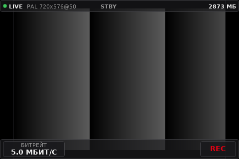
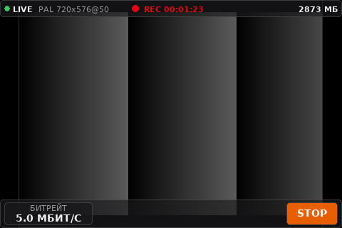
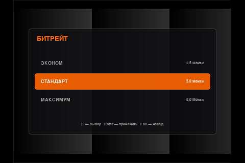
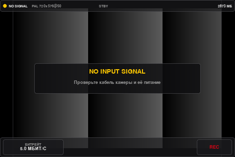

# Pi2B Recorder — DIY PowerPlay DVR (Raspberry Pi)

Портативный аналоговый / FPV видеорекордер с экраном — открытый DIY-аналог **ImmersionRC PowerPlay** на базе **Raspberry Pi 2B** (Linux) и USB-видеограббера.

Проект находится в активной стадии разработки и отладки на реальном железе.

---

## Скриншоты интерфейса

| Режим ожидания (`LIVE`) | Идёт запись (`REC`) |
| :---: | :---: |
|  |  |

| Меню выбора битрейта | Нет видеосигнала (`NO SIGNAL`) |
| :---: | :---: |
|  |  |

---

## Возможности

### Реализовано сейчас (софт)
- **Захват аналогового видео через V4L2 + GStreamer:**
  - Автоопределение и проверка совместимости видеограббера (`v4l2_checker.py`) с автоподбором ближайшего рабочего режима.
  - Поддержка **MacroSilicon MS210x / EasierCAP (`534d:0021`)** (`MJPG` до `720×480@25–30`, `YUY2` `480×320`).
  - Поддержка **Fushicai UTV007 (`1b71:3002`)** (чересстрочный `YUYV` 25 / 29.97 к/с с деинтерлейсом через GStreamer `deinterlace` для получения 50p / 59.94p).
  - Переключение разрешения, FPS и формата (`MJPG` / `YUYV`) «на лету» из списка реальных режимов подключённого свистка (клавиша `M`).
  - Автоматический `videoscale` на ветке превью до `480×320`, при этом на запись передаётся полное выбранное разрешение.
  - Горячее переподключение USB-свистка без падения программы (`NO DEVICE` → `LIVE`).
- **Аппаратная запись видео:**
  - Кодирование в **H.264** через аппаратный энкодер Raspberry Pi (`v4l2h264enc`) и упаковка в **MKV** (`matroskamux`) с корректным финализированием файла по EOS (в том числе по `SIGTERM` / `SIGINT`).
  - Три пресета битрейта:
    - **ЭКОНОМ** — `2.5 Мбит/с` (~1.1 ГБ/час)
    - **СТАНДАРТ** — `5.0 Мбит/с` (~2.2 ГБ/час)
    - **МАКСИМУМ** — `8.0 Мбит/с` (~3.6 ГБ/час)
  - Запись файлов вида `~/Videos/REC_YYYYMMDD_HHMMSS.mkv`.
- **GPU-ускоренный интерфейс (Pygame + SDL2 Renderer, холст `480×320`):**
  - Аппаратный вывод и масштабирование через **`pygame._sdl2.video` (`Window`, `Renderer`, `Texture`, `logical_size=(480, 320)`)** — стабильный вывод в окне и в `1920×1080` fullscreen (`present ~8–12 мс`), стабильное потребление памяти (`RSS ~100–116 МБ` даже во время записи).
  - Компоновка и индикация в стилистике камер Sony NEX: статусы `LIVE`, `STBY`, `REC` с таймером, `NO DEVICE`, `NO SIGNAL`, `MEMORY FULL`, остаток места на диске.
  - Модальные меню выбора битрейта (`B`) и режима захвата (`M`).
  - Экран диагностики USB-устройства (`D`) со скроллом, VID/PID, путём устройства и списком поддерживаемых режимов.
  - Браузер записей (`F`, в доработке).
  - Автономный селфтест интерфейса и преобразования кадров (`ui_selftest.py`) с генерацией 7 PNG-скриншотов без подключённого граббера.

### Планируется (железо, корпус и софт)
- Полноценное **сенсорное / свайп-управление** (без клавиатуры).
- Доработка навигации и удаления файлов в браузере записей (`F`).
- Автономное питание от двух аккумуляторов **18650** (BMS, плата заряда/разряда, мониторинг напряжения).
- Выбор записи на встроенную память или USB-флешку, выбор контейнера (`MP4` / `MKV`) и частоты кадров (`25/30/50/60 fps`).
- Вывод звука с предпросмотра / сквозной аудиовыход 3.5 мм и виброотклик.
- Кастомный корпус для 3D-печати.

---

## Структура проекта

| Файл | Назначение |
| --- | --- |
| `main.py` | Точка входа, главный цикл Pygame, инициализация SDL2 GPU-рендера, CLI-флаги, профилирование таймингов/RSS и обработка сигналов завершения |
| `config.py` | Настройки холста (`480×320`), видеостандартов (`PAL`/`NTSC`/`auto`), профилей битрейта и поддерживаемых USB-устройств |
| `v4l2_checker.py` | Поиск видеоустройства по `/dev/v4l/by-id/`, чтение форматов V4L2 и автоподбор режима |
| `recorder.py` | Управление конвейерами GStreamer (захват с `tee`, `videoscale` для превью, `appsink` и аппаратная запись H.264 → MKV) |
| `video_view.py` | Чтение и преобразование `RGB`/`I420` кадров из `appsink` в `pygame.Surface` |
| `ui.py` | Отрисовка интерфейса `480×320`, модальных окон, меню битрейта, меню режимов захвата и экранов диагностики/записей |
| `ui_selftest.py` | Автотест UI, `RGB`/`I420` конвертации и логики перерисовки в headless-режиме (`SDL_VIDEODRIVER=dummy`) |

---

## Требования

- **Плата:** Raspberry Pi (тестируется на **Raspberry Pi 2B v1.1** под **Raspberry Pi OS Lite Trixie**)
- **Питание:** стабильный блок питания **5 В, 2.5–3 А** (при слабом БП/кабеле во время записи и работы граббера возможен `Undervoltage` и троттлинг CPU)
- **Видеограббер:**
  - Целевой: USB-свисток на базе **Fushicai UTV007 (`1b71:3002`)** (для честных 50p / 59.94p)
  - Текущий тестовый: **MacroSilicon MS210x (`534d:0021`)** *(ограничен `25–30p` на уровне чипа; рекомендуется использовать в режиме `MJPG`, так как `YUYV` на этом чипе может давать тиринг)*
- **Python 3** и системные пакеты:
  - `pygame`, `numpy`, `PyGObject` (`gi`)
  - GStreamer 1.0 (`v4l2src`, `jpegdec`, `videoscale`, `deinterlace`, `videoconvert`, `v4l2h264enc`, `h264parse`, `matroskamux`)
  - Шрифт `/usr/share/fonts/truetype/dejavu/DejaVuSans.ttf`

Установка зависимостей на Raspberry Pi OS (Debian):

```bash
sudo apt update
sudo apt install -y \
  python3-pygame python3-numpy python3-gi \
  gir1.2-gstreamer-1.0 gir1.2-gst-plugins-base-1.0 \
  gstreamer1.0-tools gstreamer1.0-plugins-base \
  gstreamer1.0-plugins-good gstreamer1.0-plugins-bad \
  fonts-dejavu-core v4l-utils
```

---

## Проверка и запуск

### 1. Проверка синтаксиса, конфига и видеограббера
```bash
python3 -m py_compile config.py v4l2_checker.py video_view.py ui.py main.py recorder.py ui_selftest.py
python3 config.py
python3 v4l2_checker.py
```

### 2. Автономный тест интерфейса (без экрана и свистка)
```bash
SDL_VIDEODRIVER=dummy SDL_AUDIODRIVER=dummy python3 ui_selftest.py
```
Проверит конвертацию `I420 -> RGB`, `sample_to_surface RGB caps`, обработку ввода и создаст 7 скриншотов состояний (`ui_shot_live.png`, `ui_shot_rec.png`, `ui_shot_menu.png`, `ui_shot_no_device.png`, `ui_shot_no_signal.png`, `ui_shot_diag.png`, `ui_shot_low_space.png`).

### 3. Запуск программы
```bash
# Обычный оконный режим (превью через appsink + SDL2 GPU)
python3 main.py

# Полноэкранный режим (аппаратное масштабирование на 1920x1080)
python3 main.py --fullscreen

# Принудительный выбор стандарта (PAL / NTSC / auto)
python3 main.py --standard NTSC

# Только запись без вывода превью
python3 main.py --preview none

# Тест UI без свистка
python3 main.py --test-ui
```

*(Примечание: режим `--preview kmssink` убран в пользу `appsink` + `SDL2 Renderer`, при его передаче программа предупреждает и автоматически запускает `appsink`.)*

---

## Управление (отладочное, с клавиатуры)

> На финальном устройстве управление будет сенсорным; клавиатурные горячие клавиши используются на этапе разработки и отладки.

| Клавиша | Действие |
| --- | --- |
| `R` | Старт / остановка записи |
| `B` | Меню выбора битрейта (`↑`/`↓`, `Enter`, `Esc`) |
| `M` | Меню выбора режима захвата: разрешение, FPS, `MJPG`/`YUYV` (`↑`/`↓`, `Enter`, `Esc`) |
| `D` | Экран диагностики USB (`↑`/`↓` скролл, `D` пересканировать, `Esc` назад) |
| `F` | Браузер записей *(в доработке)* |
| `Q` | Выход из программы |

---

## Текущий статус (WIP)

- [x] Базовый интерфейс `480×320` и состояния записи/ошибок
- [x] Автоподбор режима V4L2 и горячее переподключение USB
- [x] Запись видео H.264 в MKV через `v4l2h264enc` (включая `720×480`)
- [x] Перевод вывода на GPU (`pygame._sdl2.video.Renderer`) и работающий fullscreen
- [x] Исправление чтения `RGB`-кадров (`appsink`) и устранение утечки памяти (`RSS ~100–116 МБ`)
- [x] Меню выбора разрешения, FPS и формата (`MJPG`/`YUYV`) прямо со свистка (`M`)
- [x] Диагностика USB со скроллом (`D`)
- [ ] Исправление навигации/удаления/выхода по `Esc` в браузере записей (`F`)
- [ ] Полноценное сенсорное / свайп-управление (вытягивание меню режимов и клики по всем кнопкам)
- [ ] Полная проверка на реальном `UTV007` в режиме `50p` / `59.94p`
- [ ] Аппаратная обвязка (2×18650, BMS, звук, вибро, 3D-корпус)

---

### Примечание автора
Проект разрабатывается и отлаживается на реальном железе с помощью ИИ-ассистентов (**Gemini** и **Nemotron 3.5 Super VL**), включая написание и актуализацию этого README.
